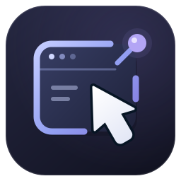

# Remote Page Agent



[English](README.md) · [中文](README.zh-CN.md)

Remote Page Agent lets an agent control pages in a mobile browser. A userscript runs in each page and communicates with a small Node.js bridge over WebSocket. The bridge exposes a limited CDP endpoint, so CDP clients can connect without enabling Chrome remote debugging on the phone.

This is an early prototype. Do not expose it directly to the public internet.

## Features

- Connect multiple pages from the same browser
- Assign a browser ID and a separate page ID to each connection
- Read page information and console messages
- Find elements with CSS selectors
- Click, type, scroll, and navigate pages
- Restrict automatic connections with an origin whitelist
- Configure the floating button opacity and command history length
- Run a limited set of page-side JavaScript commands
- Expose connected pages through `/json/list` and a small CDP WebSocket API

## Feature status

| Feature | Status | Notes |
| --- | --- | --- |
| Userscript connection to mobile pages | ✅ Complete | Connects to the Node.js bridge over WebSocket. |
| Multiple pages and page IDs | ✅ Mostly complete | Keeps separate browser and page IDs and preserves pages during brief disconnects. |
| WebSocket heartbeat | ✅ Complete | The bridge sends a protocol-level `ping` every 30 seconds to detect dead connections. |
| Automatic reconnect | ✅ Mostly complete | Uses exponential backoff, jitter, network recovery, and foreground reconnects. |
| Long-running background use | ⚠️ Known limitation | The connection can still be interrupted when the mobile OS freezes or kills the browser. |
| Reconnect after navigation | ✅ Complete | Restores the same logical page after a reload or navigation. |
| Page text, links, and page information | ✅ Complete | Supports DOM summaries and fixed page information commands. |
| Accessibility Snapshot | ✅ Complete | Includes roles, names, URLs, states, and interaction properties. Coverage is smaller than full CDP. |
| Snapshot compaction | ✅ Complete | Folds layout nodes and removes clearly decorative SVGs while preserving interactive descendants. |
| Click, type, scroll, and navigation | ⚠️ Compatibility issues remain | Works on ordinary pages; some clicks on dynamic pages such as GitHub still need work. |
| Console messages | ✅ Complete | Forwards page events through the limited CDP interface. |
| Restricted page-side JavaScript | ⚠️ Intentionally limited | Allows fixed commands and a small expression allowlist, not arbitrary JavaScript. |
| Origin whitelist | ✅ Complete | Limits which pages may connect automatically. |
| Token authentication | ✅ Complete | Supports a shared connection token. |
| WSS, origin checks, and fine-grained permissions | ❌ Not implemented | The current version should not be exposed directly to the public internet. |
| Full Chrome DevTools Protocol | ❌ Not implemented | Only the subset needed by Puppeteer/MCP is implemented. |
| Browser extension version | ❌ Not implemented | The project still uses a userscript; the migration plan is in `docs/userscript-to-extension.md`. |

## Project layout

```text
packages/
├── remote-userscript/  # Runs in the mobile browser
└── cdp-bridge/         # WebSocket server and CDP adapter
docs/                   # Protocol and migration notes
```

## Run it locally

You need Node.js 20 or newer and pnpm.

```bash
pnpm install
pnpm build
pnpm check
pnpm --filter @remote-page-agent/cdp-bridge start
```

The bridge listens on port `9222` by default. To allow a phone on the same LAN to connect:

```bash
HOST=0.0.0.0 PUBLIC_HOST=192.168.1.10 \
  pnpm --filter @remote-page-agent/cdp-bridge start
```

Install `packages/remote-userscript/dist/remote-agent.user.js` in Tampermonkey or another userscript manager. Open the script menu and choose **Configure Remote Page Agent**. The default URL is `ws://localhost:9222/agent`. If the bridge runs on another device, replace `localhost` with that device's LAN address.

The userscript manager stores the bridge URL, browser ID, and other settings outside the page's `localStorage`. Pages and domains using the same script installation share these settings, while each page keeps its own connection and page ID.

Configure the MCP client to use the bridge's CDP endpoint:

```text
http://server-address:9222
```

## Security

The bridge supports an optional shared token. It still uses plain WebSocket connections and allows limited JavaScript evaluation, so keep it on a trusted network. If you need to run it outside a private network, use the token and add WSS, origin checks, command permissions, timeouts, and stricter evaluation rules. Do not send passwords, cookies, or other sensitive page data by default.

## More notes

- `docs/message-protocol.md` describes the userscript/bridge message format.
- `docs/implementation-plan.md` records the planned phases.
- `docs/userscript-to-extension.md` describes the future extension migration.
